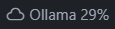
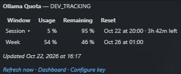
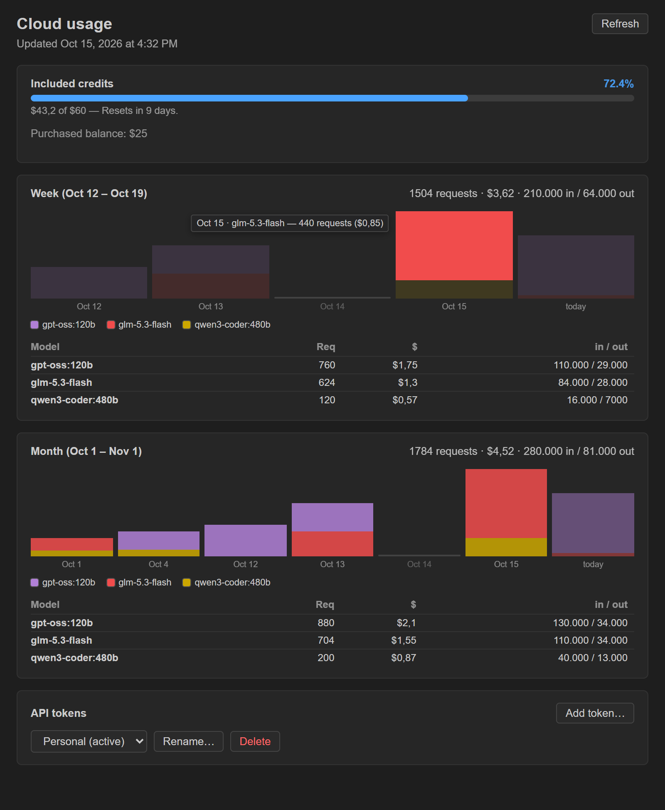
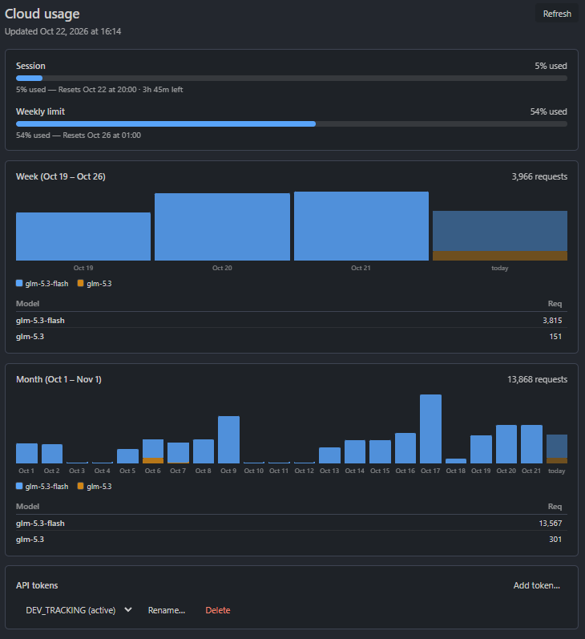

# Ollama Quota Tracker (Unofficial)

Displays your remaining **Ollama Cloud** quota in the VS Code status bar.

> **Note:** this extension is not affiliated with Ollama. It is an independent project, and it tracks **Ollama Cloud quota only** — other AI services are out of scope.

## Features

- Queries Ollama's documented endpoints (`https://ollama.com/api/balance` and `/api/usage`) using an API key created at `https://ollama.com/settings/keys`.
- Shows the **used %** (default) or the **remaining %** in the Status Bar, controlled by the `ollamaQuota.displayMode` option.
- **Dashboard webview**: click the status bar item (or run `Ollama Quota: Open Dashboard`) for quota meters, daily usage charts of the active week and month, and token management. On plans with model data the chart bars are **stacked by model** with a colour legend, alongside a per-model usage breakdown. Charts adapt to narrow panels.

Dashboard (credits plan — meters, week/month charts stacked by model with a colour legend, per-model tables and the token selector):

Dashboard (legacy plan — session/weekly meters; usage charts carry no model tables because legacy usage reports no model data):

- **Multiple API tokens**: store several named keys and switch between them; only the active one is polled, so the shared rate limit (10 requests/minute) is respected.
- Tooltip and dashboard timestamps (resets, update times, chart labels) rendered as e.g. `Nov 1 at 1:00 AM`; the clock can be forced to 12‑ or 24‑hour via `ollamaQuota.tooltipTimeFormat`.
- Detailed tooltip: a per-window table (session and week, or credits) with usage, remaining, and reset times, plus the purchased balance and footer links. On the legacy plan the session row (tooltip and dashboard) also shows the compact time to reset, e.g. `5h 23m left`.
- Configurable auto-refresh (60 s by default; 0 = disabled; values below 30 s are clamped to 30 to protect the rate limit).
- Keeps the last valid value if a query fails (per token: stale data from a previous token is never shown for the current one).

## Usage

1. Install the extension.
2. Create an API key at `https://ollama.com/settings/keys`.
3. Run the `Ollama Quota: Manage API Keys` command (or click the status bar item without a token) to add your first key.
4. Your quota appears in the Status Bar; click it to open the Dashboard, where you can add/rename/delete tokens, switch the active one and view the weekly/monthly usage charts.

## Configuration

| Option | Default | Description |
| --- | --- | --- |
| `ollamaQuota.refreshInterval` | `60` | Polling interval in seconds (0 = disabled; values below 30 are clamped to 30 to protect the shared rate limit). |
| `ollamaQuota.displayMode` | `used` | Displayed percentage: `used` (consumed) or `remaining` (left). |
| `ollamaQuota.warnThreshold` | `20` | ⚠ icon when the remaining % is less than or equal to this value. |
| `ollamaQuota.tooltipTimeFormat` | `auto` | Hour format of the tooltip timestamps (`auto` = editor locale, or force `12h` / `24h`). |

## Releases

Releases are automated with **[semantic-release](https://semantic-release.org)** on GitHub Actions (`.github/workflows/release.yml`). Every push to `main` runs the compile + unit tests and, when the commits follow [Conventional Commits](https://www.conventionalcommits.org), it automatically:

1. bumps the version in `package.json`,
2. appends the new entry to `CHANGELOG.md` (generated from the commit messages),
3. builds the VSIX, bundling the repo's `README.md` and `CHANGELOG.md` — these feed the Marketplace listing and its changelog tab,
4. publishes that exact VSIX to the **VS Code Marketplace** (requires the `VSCE_PAT` repository secret; skipped with a warning if it is not set),
5. pushes the `vX.Y.Z` tag and publishes a **GitHub Release** with the VSIX attached.

Marketplace publishing uses a Personal Access Token with the **Marketplace "Manage" scope** (all accessible organizations), stored as the `VSCE_PAT` repository secret. The workflow pre-flights the secret before releasing: if `VSCE_PAT` is missing or empty, the run fails with an actionable error instead of silently publishing only to GitHub Releases. Note that a version already published to the Marketplace can never be overwritten, so the listing (README, screenshots, changelog tab…) only refreshes on each new release.

The release commit (`chore(release): X.Y.Z [skip ci]`) is created by the bot itself, so no version has to be bumped manually anymore.

Supported commit prefixes:

| Commit message | Version bump | Example |
| --- | --- | --- |
| `fix: ...` | patch | `0.4.3 → 0.4.4` |
| `feat: ...` | minor | `0.4.3 → 0.5.0` |
| `docs: ...` | patch | `0.6.0 → 0.6.1`² |
| `feat!:` or `BREAKING CHANGE:` in the body | major | `0.4.3 → 1.0.0`¹ |
| anything else (`chore:`, `ci:`, `style:`, `refactor:`, …) | none (no release) | — |

¹ While the version is `0.x`, a *major* bump stays in the `0.x` series.

² `docs:` releases a patch because the `README.md` bundled in the VSIX is the Marketplace listing — documentation changes need a new version to become visible there.

To preview what a push would release without touching anything, run `npm run release:dry`.

## Privacy

- All API keys are stored **only** in VS Code's local `SecretStorage`. They are never written to `settings.json`, logs, or telemetry.
- This extension does not collect telemetry or usage data.

## Disclaimer

- This project is not affiliated with Ollama.
- This extension monitors **Ollama Cloud only**; it does not track quota for other AI tools or providers.
- The API key is used solely to query the quota.

## License

MIT
